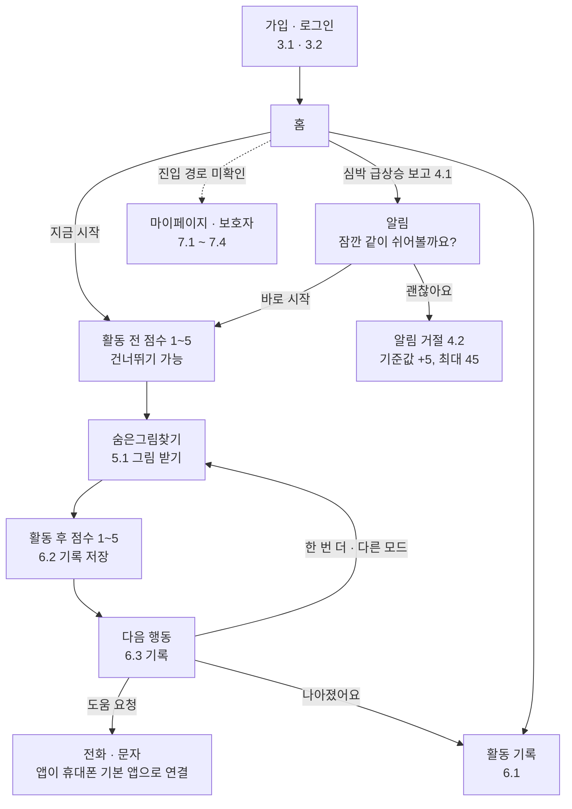

# 잠깐의 쉼 (pulse) 백엔드

간지톤 2026 23조 "잠깐의 쉼" 앱의 API 서버다. 애플워치 심박이 갑자기 오르면 알림을 띄우고, 숨은그림찾기로 지금 여기에 주의를 돌리도록(그라운딩) 돕는다.

**현재 상태 (2026-11-18)**: API 명세 v0.2의 12개 중 12개 완료. 자세한 내용은 [API 구현 현황](#api-구현-현황)에 있다.

이 README는 사람과 코딩 에이전트가 "지금 어디까지 됐고 누가 무엇을 했는지" 확인하는 문서다. 에이전트 작업 규칙은 [AGENTS.md](AGENTS.md)에 있다.

## 서비스 흐름



- 노드의 숫자는 [docs/API명세서.md](docs/API명세서.md)의 절 번호다. URL과 구현 상태는 [API 구현 현황](#api-구현-현황)에 있다.
- 심박 판단은 앱이 하고, 급상승일 때만 4.1을 부른다. 알림을 띄울지는 서버가 `shouldAlert`로 정한다.
- 활동 전 점수는 따로 보내지 않는다. 6.2 기록 저장 때 `beforeScore`로 함께 보낸다.
- "다른 모드"는 서버에 기록하지 않는다. 앱이 다른 `mode`로 5.1을 다시 부른다.
- Figma에는 숨은그림찾기 뒤에 "현실 미션" 단계가 남아 있다. 팀 결정(명세 8.1)으로 뺐다. Figma와 명세의 차이는 [docs/화면흐름.md](docs/화면흐름.md)에 정리했다.

## 빠른 시작

요구 사항은 JDK 21이다. Gradle은 저장소에 든 wrapper(9.3.0)를 쓰므로 따로 설치하지 않는다.

```bash
./gradlew bootRun   # http://localhost:8080
./gradlew test      # 53개: PulseFlowTest 33, PictureCatalogTest 15, PictureServiceTest 3, PictureControllerTest 2
```

Windows에서는 `gradlew.bat bootRun`, `gradlew.bat test`로 실행한다.

### 로컬 DB와 H2 콘솔

로컬 DB는 메모리 H2다. 스키마는 `ddl-auto: create-drop`으로 만들기 때문에 서버를 끄면 테이블과 데이터가 모두 사라진다. 서버를 다시 켜면 가입부터 다시 한다. 테스트도 같은 설정을 쓴다.

서버가 켜져 있을 때 브라우저로 DB를 볼 수 있다.

| 항목 | 값 |
|---|---|
| 주소 | http://localhost:8080/h2-console |
| JDBC URL | `jdbc:h2:mem:pulse;MODE=MySQL;DB_CLOSE_DELAY=-1` |
| User Name | `sa` |
| Password | 비워 둔다 |

### 프로필과 환경변수

지금은 배포 서버 없이 로컬 H2로 개발한다. `prod` 프로필은 서버가 생길 때를 위한 설정이다.

| 프로필 | DB | 스키마 | H2 콘솔 | JWT 시크릿 | 그림 기준 주소 |
|---|---|---|---|---|---|
| 기본 (로컬·테스트) | H2 메모리 | `create-drop` | 켬 | `JWT_SECRET`, 없으면 개발용 기본값 | `PULSE_PUBLIC_BASE_URL`, 없으면 요청 주소 |
| `prod` | `DB_URL` (MySQL 드라이버 포함) | `update` | 끔 | `JWT_SECRET` 필수 | `PULSE_PUBLIC_BASE_URL` 필수 |

| 환경변수 | 용도 | 기본값 |
|---|---|---|
| `SPRING_PROFILES_ACTIVE` | 프로필 선택 (`prod`) | 없음 (기본 프로필) |
| `JWT_SECRET` | JWT 서명 키, 32바이트 이상 | 기본 프로필은 개발용 문자열, `prod`는 없음 (없으면 기동 실패) |
| `JWT_EXPIRATION_MINUTES` | 토큰 만료 시간(분) | `1440` (24시간) |
| `PULSE_PUBLIC_BASE_URL` | 그림 `imageUrl`의 기준 주소. 프록시 뒤에서 이 값이 없으면 `Host` 헤더가 그대로 들어가 `http://` 주소가 나가고 iOS가 이미지를 막는다 | 기본 프로필은 빈 값 (요청을 받은 서버 주소), `prod`는 없음 (없으면 기동 실패) |
| `DB_URL` · `DB_USERNAME` · `DB_PASSWORD` | `prod` DB 접속 정보 | 없음 (`prod`에서 필수) |

`application.yml`의 서비스 설정값은 다음과 같다.

| 키 | 값 | 뜻 |
|---|---|---|
| `pulse.alert.base-threshold` | `25` | 알림 기준. 평소 대비 bpm 상승폭의 시작값 |
| `pulse.alert.dismiss-step` | `5` | "괜찮아요" 한 번에 올리는 기준값 |
| `pulse.alert.max-threshold` | `45` | 기준값 상한 |
| `pulse.public-base-url` | `''` | 그림 `imageUrl`의 기준 주소. 비우면 요청을 받은 서버 주소를 쓴다. `application-prod.yml`은 기본값 없이 `PULSE_PUBLIC_BASE_URL`을 요구한다 |
| `pulse.cors.allowed-origin-patterns` | `'*'` | CORS 허용 Origin 패턴. 쉼표로 여러 개. 배포 때 FE 도메인으로 좁힌다 |

## 기술 스택과 패키지 구조

| 구분 | 내용 |
|---|---|
| 언어 · 빌드 | Java 21, Spring Boot 3.4.5, Gradle wrapper |
| 웹 · 검증 | Spring Web, Bean Validation |
| 데이터 | Spring Data JPA, H2 (로컬·테스트), MySQL 드라이버 (`prod`용) |
| 인증 | jjwt 0.12.6, `spring-security-crypto`(BCrypt만 사용) |
| 기타 | Lombok 없음, DTO는 record |

Spring Security 필터 체인은 쓰지 않는다. `AuthInterceptor`(`HandlerInterceptor`)가 `/api/v1/**` 요청의 JWT를 확인하고, `/api/v1/auth/**`는 인증 없이 통과시킨다.

```
src/main/java/com/ganzithon/pulse
├── PulseApplication.java
├── controller/     AuthController · AlertController · RecordController · PictureController · UserController
├── service/        AuthService · AlertService · RecordService · PictureService · UserService
├── repository/     UserRepository · AlertRepository · RecordRepository · PictureCatalog (그림 JSON 카탈로그)
├── entity/         User · Alert · ActivityRecord · Mode · NextAction
├── dto/
│   ├── auth/       SignupRequest · LoginRequest · AuthResponse · UserInfo
│   ├── alert/      SpikeRequest · SpikeResponse
│   ├── record/     RecordRequest · RecordResponse · NextActionRequest
│   ├── picture/    PictureResponse · TargetResponse
│   └── user/       GuardianRequest · GuardianResponse · MeResponse · UpdateMeRequest
└── global/
    ├── auth/       AuthInterceptor · JwtProvider
    ├── config/     WebConfig (CORS, 인터셉터 등록, PasswordEncoder)
    ├── exception/  ErrorCode · BusinessException · ErrorResponse · GlobalExceptionHandler
    ├── response/   ApiResponse
    └── util/       TimeFormat · PublicUrlResolver · StrictIntegerDeserializer
src/main/resources/pictures/catalog.json   (그림과 대상 좌표)
src/main/resources/static/pictures/        (그림 이미지, 아직 없음)
src/test/java/com/ganzithon/pulse
├── PulseFlowTest.java
├── controller/     PictureControllerTest (PICTURE-001의 HTTP 응답)
├── repository/     PictureCatalogTest
└── service/        PictureServiceTest
src/test/resources/static/pictures/test-pixel.png   (정적 이미지 경로 확인용)
```

계층 규칙은 다음과 같다. 전체 규칙은 [AGENTS.md](AGENTS.md)에 있다.

- 요청은 Controller → Service → Repository 한 방향으로 흐른다. Controller는 Entity와 Repository를 직접 다루지 않는다.
- DTO는 `dto/<도메인>/`에 record 하나당 파일 하나로 둔다. Entity를 DTO로 바꿀 때는 DTO의 `from()`을 쓴다.
- 오류는 `BusinessException(ErrorCode.X)`로 던진다. `GlobalExceptionHandler`가 명세 2.3 형식으로 바꾼다. 성공 응답은 `ApiResponse`로 감싼다.
- 로그인한 사용자 ID는 `@RequestAttribute(AuthInterceptor.USER_ID)`로 받는다. 응답 시각은 `TimeFormat.iso()`로 만든다(`+09:00`).

## API 구현 현황

기준은 [docs/API명세서.md](docs/API명세서.md) v0.2다. URL은 모두 `/api/v1` 아래에 있다. API 상태를 바꾼 사람이 이 표를 함께 고친다.

| 명세 | Method | URL | 상태 | OpenSpec |
|---|---|---|---|---|
| 3.1 | POST | `/auth/signup` | 완료 | 기준 스펙 `auth` |
| 3.2 | POST | `/auth/login` | 완료 | 기준 스펙 `auth` |
| 4.1 | POST | `/heart-rate/spikes` | 완료 | 기준 스펙 `heart-rate-alert` |
| 4.2 | POST | `/alerts/{alertId}/dismiss` | 완료 | 기준 스펙 `heart-rate-alert` |
| 5.1 | GET | `/pictures/next` | 완료 (그림 데이터는 확정 전 명세 예시) | `add-picture-next` |
| 6.1 | GET | `/records` | 완료 | 기준 스펙 `activity-record` |
| 6.2 | POST | `/records` | 완료 | 기준 스펙 `activity-record` |
| 6.3 | POST | `/records/{recordId}/next-action` | 완료 | 기준 스펙 `activity-record` |
| 7.1 | GET | `/users/me` | 완료 | 기준 스펙 `user-profile` |
| 7.2 | PATCH | `/users/me` | 완료 | 기준 스펙 `user-profile` |
| 7.3 | PUT | `/users/me/guardian` | 완료 | 기준 스펙 `guardian-contact` |
| 7.4 | DELETE | `/users/me/guardian` | 완료 | 기준 스펙 `guardian-contact` |

- 공통 규칙(명세 2장)인 응답 형식, 오류 응답, 시각 형식은 구현돼 있다(기준 스펙 `api-common`).
- 5.1의 이미지 파일과 좌표는 팀 확정 전이라 `catalog.json`은 명세 예시 데이터이고, 이미지 파일이 아직 없어 `imageUrl`(`/pictures/park_01.png`)은 404다. 색 모드 그림도 없어 `mode=COLOR`는 404 `PICTURE-001`이다.
- 6.1·6.2의 `activityName`은 지금 `"숨은그림찾기"`로 고정돼 있다(`RecordService.DEFAULT_ACTIVITY`).
- 변경별 진행 상황은 `openspec list`로 확인한다.

## 팀과 역할

| 이름 | GitHub | 맡아 온 영역 |
|---|---|---|
| 홍명철 | [hmc1206](https://github.com/hmc1206) | 초기 뼈대(인증·심박 알림·활동 기록 API), API 명세서 v0.1·v0.2, 개발 현황 문서 |
| 윤준하 | [YJlang](https://github.com/YJlang) | 계층형 패키지 리팩토링, 오류 수정 7건, 테스트 분리, OpenSpec 작업 환경, Figma 화면 흐름 정리, README |

백엔드 두 사람은 세부 분담을 하지 않는다. 둘 다 코딩 에이전트로 개발하고, 작업을 시작할 때 이 README와 `openspec list`를 보고 남은 일을 이어받는다.

1. `git pull`로 최신 상태를 받는다.
2. 이 README의 [API 구현 현황](#api-구현-현황)과 [기여 기록](#기여-기록)에서 마지막으로 끝난 일을 확인한다.
3. `openspec list`에서 진행 중인 변경과 남은 작업을 보고, 이어서 할 변경을 고른다.

## 기여 기록

### 커밋 대기 중인 작업

지금은 없다. 커밋하지 않은 작업이 생기면 이름과 함께 여기에 적고, 커밋되면 지운다. 커밋은 아래 "커밋 기록"에 자동으로 들어간다.

### 커밋 기록

이 구간은 `scripts/update-contributions.sh`가 `git log`로 만든다. 손으로 고치지 않는다. 커밋한 뒤 `./scripts/update-contributions.sh`를 다시 실행하고, 바뀐 README는 다음 커밋에 넣는다(README를 갱신한 커밋 자체는 그다음 실행 때 들어간다). 날짜는 KST 기준이고 merge 커밋은 뺀다.

<!-- CONTRIBUTIONS:START -->

**사람별 커밋 수** (merge 커밋 제외)

| 이름 | 커밋 | 최근 커밋 |
|---|---|---|
| 윤준하 | 7 | 2026-11-18 |
| 홍명철 | 5 | 2026-11-18 |

#### 2026-11-18

- 윤준하 · [`f6b2036`](https://github.com/2026Ganzi-Thon/2026_GANZITHON_TEAM_23_BE/commit/f6b20364603ace327a435809514fb289877955f3) · feat: 숨은그림 받기 API (명세 5.1)
- 윤준하 · [`1a3f36a`](https://github.com/2026Ganzi-Thon/2026_GANZITHON_TEAM_23_BE/commit/1a3f36ab3d87505b54bbd607bbb2fb9f46cdebfd) · feat: 마이페이지와 보호자 연락처 API (명세 7.1~7.4)
- 윤준하 · [`4fe974d`](https://github.com/2026Ganzi-Thon/2026_GANZITHON_TEAM_23_BE/commit/4fe974d5acd1fe655deb7d8532f45dfb5a289c8e) · feat: 활동 기록에 mode·nextAction 추가, 다음 행동 기록 API (명세 6.1~6.3)
- 윤준하 · [`a1c1d28`](https://github.com/2026Ganzi-Thon/2026_GANZITHON_TEAM_23_BE/commit/a1c1d28a79a1e4f3c47f116baf82a8279f68dd5e) · docs: README 기여 기록 갱신
- 윤준하 · [`c939e67`](https://github.com/2026Ganzi-Thon/2026_GANZITHON_TEAM_23_BE/commit/c939e67b9eaebd6bca68567fffb90b761fb12ff5) · docs: README·AGENTS 추가, 화면 흐름 정리, 개발 현황 갱신
- 윤준하 · [`f841eb9`](https://github.com/2026Ganzi-Thon/2026_GANZITHON_TEAM_23_BE/commit/f841eb9199032cd883367816a847bbd6a67e1550) · docs: OpenSpec spec-driven 환경 추가 (기준 스펙 4개, 변경 제안 3개)
- 윤준하 · [`d329980`](https://github.com/2026Ganzi-Thon/2026_GANZITHON_TEAM_23_BE/commit/d329980722c3dcf6c5646731b603e6e0913c7d7c) · refactor: 계층형 MVC 구조로 재구성하고 DTO 분리, 오류 7건 수정
- 홍명철 · [`46124a8`](https://github.com/2026Ganzi-Thon/2026_GANZITHON_TEAM_23_BE/commit/46124a873cc40df3d55416b016401f0d71b269d0) · docs: 숨은그림 응답 예시를 실제 그림 기준으로 수정
- 홍명철 · [`1256771`](https://github.com/2026Ganzi-Thon/2026_GANZITHON_TEAM_23_BE/commit/1256771027c85b8ee33a99ff225f45999a47ba7b) · docs: API 명세서 v0.2 (팀 결정 반영)
- 홍명철 · [`8e50e19`](https://github.com/2026Ganzi-Thon/2026_GANZITHON_TEAM_23_BE/commit/8e50e195c403297719ecb5ff445ef9e5ab533e11) · docs: 백엔드 개발 현황과 앞으로 할 일 정리
- 홍명철 · [`d0365d2`](https://github.com/2026Ganzi-Thon/2026_GANZITHON_TEAM_23_BE/commit/d0365d28040c06ddcafac376d63deb105a389390) · feat: 인증·심박 알림·활동 기록 API 초기 구현
- 홍명철 · [`62e5995`](https://github.com/2026Ganzi-Thon/2026_GANZITHON_TEAM_23_BE/commit/62e59954bbac67ddad753a10450ccbcf19eacd07) · Create API명세서.md

<!-- CONTRIBUTIONS:END -->

## 작업 방식 (spec-driven)

새 기능과 동작 변경은 OpenSpec 변경 제안으로 시작한다. 명세서에 없는 API를 제안 없이 추가하지 않는다.

1. **제안**: `/openspec-propose`로 `openspec/changes/<변경 이름>/`에 `proposal.md` · `design.md` · `specs/` · `tasks.md`를 만든다.
2. **검토**: 제안을 읽고 `openspec validate <변경 이름> --strict`로 형식을 확인한다.
3. **구현**: `/openspec-apply-change <변경 이름>`으로 `tasks.md`를 따라 구현한다.
4. **테스트**: `./gradlew test`가 통과해야 끝난 것이다.
5. **아카이브**: `/openspec-archive-change <변경 이름>`으로 변경의 스펙을 `openspec/specs/`에 합치고 변경 폴더를 `openspec/changes/archive/`로 옮긴다.
6. **기록**: README의 [API 구현 현황](#api-구현-현황) 표를 고치고, 커밋한 뒤 `./scripts/update-contributions.sh`를 실행한다.

스킬은 `.agents/skills/openspec-*`에 있다. Claude Code는 `.claude/skills/`의 링크로 같은 스킬을 읽고 `/openspec-propose`처럼 부른다. 그 밖에 `/openspec-explore`(구현 전 생각 정리), `/openspec-update-change`(제안 수정), `/openspec-sync-specs`(아카이브 없이 스펙만 반영)가 있다.

| CLI | 용도 |
|---|---|
| `openspec list` | 진행 중인 변경과 작업 진행률 |
| `openspec list --specs` | 기준 스펙 목록 |
| `openspec show <이름>` | 변경 또는 스펙 내용 |
| `openspec status --change <이름>` | 변경의 산출물(proposal · specs · design · tasks) 작성 상태 |
| `openspec validate --all --strict` | 모든 변경과 스펙의 형식 검사 |

## 문서

- [docs/API명세서.md](docs/API명세서.md): API 명세 v0.2. FE와 맞춘 기준 문서
- [docs/개발현황.md](docs/개발현황.md): 개발 현황, 남은 작업, 팀에 물어볼 것
- [docs/화면흐름.md](docs/화면흐름.md): Figma 화면 흐름과 명세 v0.2와의 차이
- [openspec/](openspec/): 기준 스펙(`specs/`)과 변경 제안(`changes/`)
- [AGENTS.md](AGENTS.md): 코딩 에이전트 작업 규칙
- FE 레포: https://github.com/2026Ganzi-Thon/2026_GANZITHON_TEAM_23_FE
