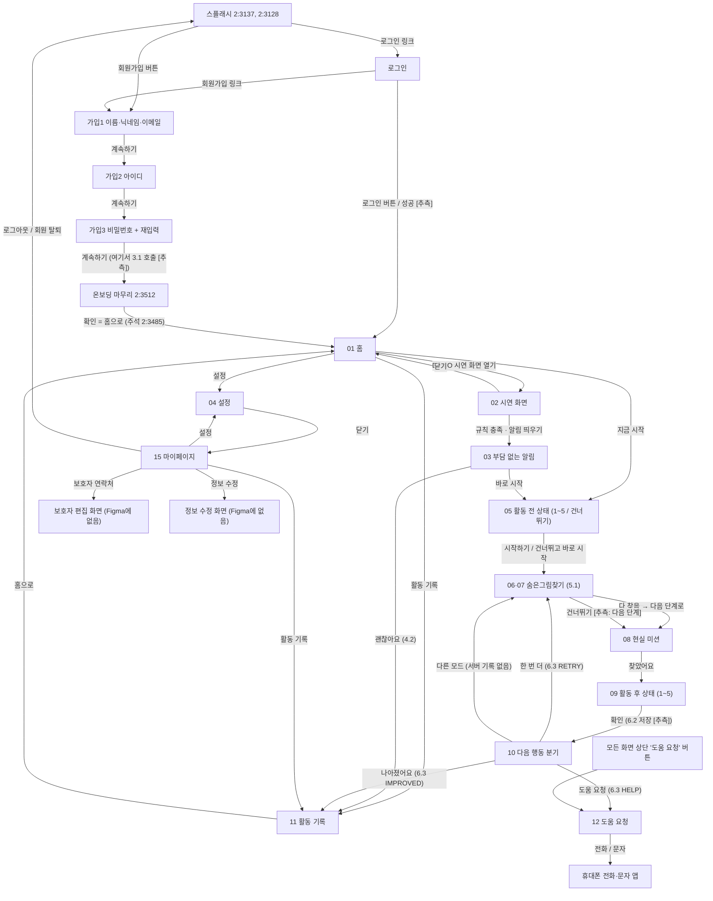

# 화면 흐름 (Figma 기준)

| 항목 | 내용 |
|---|---|
| 출처 | Figma 파일 키 `Tgqjdx9XzPPgIQjSCJpfmF` |
| 조사일 | 2026-11-18 |
| 비교 기준 | `docs/API명세서.md` v0.2 (3.1~7.4) |
| 한계 | 프로토타입 연결선(prototype reactions)은 읽지 못했다. 흐름은 섹션 제목, 화살표, 화면 번호, 버튼 문구로 읽었고 일부는 추정이다 |

표기: **[본]** 화면에서 직접 확인 · **[메타]** Figma 텍스트 레이어 이름으로 확인 · **[추측]** 화면 배치·번호·화살표로 추정

팀에 물어볼 항목은 [개발현황.md](개발현황.md) 5장에 모았다.

---

## 1. 요약

1. 파일은 페이지 2개다. `와이어프레임`(0:1)에 전체 화면이 있고 `UIUX`(1:2)는 비어 있다.
2. `와이어프레임` 안은 세 묶음이다. (a) 회원가입·로그인 계열 393×852 화면 37장 (b) 번호가 붙은 402×874 화면 01~12, 15 및 변형 (c) HTML 시안 캡처 섹션 2개(`wireframe_design.html` 29:1920, `design` 33:2859). (c)는 옛 시안이라 (a)(b)와 내용이 충돌한다.
3. 핵심 흐름은 스플래시 → 가입/로그인 → 홈 → (알림 또는 "지금 시작") → 활동 전 점수(1~5, 건너뛰기 가능) → 숨은그림찾기 → **현실 미션** → 활동 후 점수 → 다음 행동 4지선다 → 기록/마이페이지/설정/도움 요청이다.
4. 명세 v0.2와 가장 크게 다른 점: **현실 미션이 정식 단계(STEP 2/2)로 남아 있고**, **비밀번호가 "10자 이상"**이며, **고양이 개수가 3(1/3)과 4(4/4)로 Figma 안에서도 어긋나고**, 주석이 **"로그인 없이 쓸 수 있다"**고 적었다.
5. 명세에 대응 API가 없는 화면 기능: 설정의 **알림 기준 N 표시 + "처음 기준으로 되돌리기"**, 마이페이지의 **회원 탈퇴**, **이번 달 활동 횟수/평균 불안 변화 통계**, 장면 화면의 **힌트 보기**. 정보 수정 화면과 보호자 입력 폼은 Figma에 화면 자체가 없다.
6. 활동 후 점수 → "확인"에서 6.2, 다음 행동 선택에서 6.3, 도움 요청 연락처(109·1577-0199·119)는 앱 고정값이고 보호자 이름·번호는 7.1에서 온다. 이 연결은 명세와 맞는다.
7. 숨은그림 장면 이미지는 Figma에 있다(공원 일러스트, 프레임 `35:2869` 402×802). 찾을 대상은 고양이이고, 이미지 원본 픽셀 크기는 Figma 메타데이터로 알 수 없다(미확인).

---

## 2. 화면 목록

번호는 Figma 프레임 이름 그대로다. 사용 API는 명세 번호다.

### (b) 번호 화면 (402×874, `와이어프레임` 0:1 안)

| 번호 | 이름 | node id | 목적 | 사용 API |
|---|---|---|---|---|
| 01 | 홈 · 수동 실행 | 9:2904 | "지금 시작" 큰 버튼, 활동 기록/설정 진입, DEMO 링크 | 없음 |
| 02 | 시연 · 모의 생체신호 감지 | 9:3086 | 지하철 시나리오 모의 심박·걸음 재생, "규칙 충족 · 알림 띄우기" | 없음(모의). 실제 보고라면 4.1 [추측] |
| 03 | 부담 없는 알림 | 9:3304 | "잠깐 같이 쉬어볼까요?" 바텀시트, 바로 시작/괜찮아요 | 4.1(앞단), 4.2(괜찮아요), 5.1(바로 시작) |
| 04 | 설정 | 9:3342 | 평소 심박, 알림 기준, 보호자 연락처, 앱 안 알림 토글 | 7.1, 7.3. 알림 기준 조회·리셋은 **API 없음** |
| 05 | 활동 전 상태 확인 | 9:3405 | 불안 정도 1~5 선택 또는 건너뛰기 | 없음(값은 6.2에서 전송) |
| 06 | 숨은그림찾기 · 색 모드 (옛 변형) | 9:3575 | "파란색을 3개 찾아보세요", 색/사물 토글, 장면 1/2 | 5.1 (mode=COLOR) |
| 07 | 숨은그림찾기 · 사물 모드 (옛 변형) | 9:3623 | "시계를 3개 찾아보세요", 장면 2/2 | 5.1 (mode=OBJECT) |
| 08 | 현실 미션 | 9:3673 | 내 주변에서 파란색 찾기, "다른 색으로 바꾸기" | **없음** |
| 09 | 활동 후 상태 확인 | 9:3733 | 불안 정도 1~5, "시작 전 4" 칩 | 6.2 |
| 10 | 다음 행동 분기 | 9:3905 | BEFORE/AFTER 요약 + 나아졌어요/한 번 더/다른 모드/도움 요청 | 6.3 (다른 모드는 5.1 재호출) |
| 11 | 활동 기록 | 9:3956 | 날짜·모드·시각·전→후 점수 목록 | 6.1 |
| 12 | 도움 요청 | 9:4048 | 109·1577-0199·119 전화, 보호자 문자 | 7.1(보호자 이름·번호) |
| 15 | 마이페이지 | 15:12189 | 프로필 카드, 이번 달 통계, 메뉴, 로그아웃/회원 탈퇴 | 7.1, 7.2(정보 수정 버튼), 통계·탈퇴는 **API 없음** |

번호 13, 14는 이 파일에 없다(번호 건너뜀).

### 최신 작업 행 (`div.row` 15:11656, 402×874): 05~09의 새 버전

| 번호 | 이름 | node id | 옛 변형과의 차이 |
|---|---|---|---|
| 05 | 활동 전 상태 확인 | 15:11657 | 9:3405와 동일 |
| 06 | 숨은그림찾기 · 장면 1 (찾는 중) | 15:11827 | 공원 일러스트 풀스크린, "고양이를 찾아보세요 1 / 3", 뒤로·힌트 버튼, "STEP 1 / 2 · 장면 1", 건너뛰기 |
| 07 | 숨은그림찾기 · 장면 2 (다 찾음) | 15:11860 | 같은 일러스트, "4 / 4", "STEP 1 / 2 · DONE", "고양이 4마리를 모두 찾았어요", [다음 단계로] |
| 08 | 현실 미션 | 15:11905 | 버튼이 "찾았어요"(옛 변형은 "===" 자리표시자) |
| 09 | 활동 후 상태 확인 | 15:11965 | 9:3733과 동일 |
| (변형) | 장면 1 단독 | 35:2860 / 일러스트 35:2869 | 15:11827과 동일 상태 |
| (복제) | 11 활동 기록 | 15:12294 | 9:3956과 동일 |
| (복제) | 12 도움 요청 | 15:12391 | 9:4048과 동일 |
| (복제) | 04 설정 | 9:3342만 있음 | 마이페이지 묶음(x≈13141~14518)에는 04 설정이 따로 놓여 있음 |

### (a) 회원가입·로그인 계열 (393×852, 프레임 2:2852 안): 모두 [본]

| 묶음 | 프레임 | node id |
|---|---|---|
| 스플래시 | 스플래쉬 (1)(2) | 2:3137(빈 화면), 2:3128("회원가입" 버튼 + "이미 계정이 있으신가요? 로그인") |
| 로그인 | 로그인 (1)~(6) | 2:3099, 2:3075, 2:3049, 2:3025, 2:2999, 2:2973 (입력 전 → 포커스 → 아이디 입력 → 비밀번호 입력 → 마스킹 → 눈 뜨기·버튼 활성) |
| 로그인 오류 | 로그인 오류 (1)~(3) | 2:2945(둘 다), 2:2918(비밀번호), 2:2891(아이디) |
| 가입 1단계: 이름·닉네임·이메일 | 가입을 위한 정보 (1)~(9) | 2:3332, 2:3311, 2:3290, 2:3269, 2:3248, 2:3227, 2:3206, 2:3185, 2:3164 |
| 가입 1단계 오류 | 가입을 위한 정보 오류 (1)~(3) | 2:3403, 2:3380, 2:3358 |
| 가입 2단계: 아이디 | 아이디 (1)~(3) | 2:3458, 2:3446, 2:3434 |
| 가입 2단계 오류 | 아이디 오류 (1) | 2:3472 |
| 가입 3단계: 비밀번호 | 비밀번호 (1)~(6) | 2:9547, 2:9530, 2:9512, 2:9494, 2:9467, 2:9440 |
| 가입 3단계 오류 | 비밀번호 오류 (1)~(3) | 2:9860, 2:9832, 2:9803 |
| 마무리 | 온보딩 마무리 | 2:3512 |

사용 API: 로그인 = 3.2, 가입 3단계 전체 = 3.1(마지막 단계에서 한 번 호출 [추측]), 스플래시·마무리 = 없음.

### (c) HTML 시안 섹션 (옛 시안, 참고용): [본]+[메타]

| 이름 | node id | 크기 | 내용 |
|---|---|---|---|
| wireframe_design.html - 07/11/2026 | 29:1920 | 2120×1401 | "잠깐의 쉼." 시안 뷰어. 사이드바에 시작/계정/홈/활동/마이페이지 목차, 스플래시만 렌더링됨 |
| design | 33:2859 | 2086×12432 | 22장 시안 (01 스플래시 ~ 22 활동 기록 예시). 비밀번호 "8자 이상", 아이디 "영문과 숫자 4자 이상", 숨은그림 "나비·꽃·찻잔 3개", 설정에 "알림 받기/효과음", "10 · 숨은그림찾기" 화면은 비어 있음 |

### 설명 주석 (표 형태 이미지, 인스턴스 `Description`)

2:2859(로그인), 2:2860(로그인 오류), 2:3427(가입 아이디), 2:3471(아이디 오류), 2:3485(마무리), 2:9431(비밀번호), 2:9795와 항목 2:9798(비밀번호 오류), 4:2429(기능 요약 텍스트 노트), 4:2430(도움 요청 고정 노트). 주석 번호 뱃지 `넘버링 (R/L)`이 화면 위에 붙어 있다.

---

## 3. 흐름

홈 열 아래에 "모의 생체 신호 감지", "부담 없는 알림", **"바로 시작 → 숨은 그림 찾기"**, **"괜찮아요 → 활동기록"**, "도움 요청을 눌렀을 때" 다섯 소제목이 있다. 마젠타 화살표 한 줄이 "바로 시작 → 숨은 그림 찾기" 라벨에서 "숨은 그림 찾기" 섹션 머리(활동 전 상태 확인 열)로 이어진다 [본]. 다른 화살표는 없다.

설명과 확신도:

- "바로 시작"(03) → 05 → 06 이후는 마젠타 화살표와 05~09 번호 순서에서 읽었다 [본+추측]. 05→06→07→08→09 순서는 `div.row`(15:11656)의 좌우 배치와 번호다 [본].
- **10 → 나아졌어요 → 11 활동 기록** [추측]. 11 상단에 "방금 활동을 기록했어요" 배너와 "홈으로" 버튼이 있고, 나아졌어요의 부제가 "기록하고 마쳐요"라서 그렇게 읽었다. 단, 이 부제 때문에 기록 저장(6.2)이 "나아졌어요"에서 일어나는지 "활동 후 점수 확인"에서 일어나는지는 Figma로 확정할 수 없다(명세는 후자).
- **03 → 괜찮아요 → 활동 기록**은 섹션 라벨 "괜찮아요 → 활동기록"에서 읽었다 [본]. 11의 "방금 활동을 기록했어요" 배너는 이 경로에서는 어색하다(활동을 안 했으므로). 같은 11 화면을 재사용한 것으로 보이며 [추측], 배너 노출 조건은 알 수 없다.
- 한 번 더 = "같은 모드로 다시 해요", 다른 모드 = "색 대신 사물로 해봐요" [본]. 어느 화면(05 또는 06)으로 돌아가는지는 안 보인다 [추측].
- 도움 요청은 모든 화면 상단 고정이라는 주석이 있다(4:2430) [본]. 12의 하단 문구도 "이 버튼은 앱의 모든 화면 위쪽에 늘 있어요" [본].
- 홈에서 마이페이지로 가는 버튼은 홈(01)에 **보이지 않는다**. 마이페이지(15)·활동 기록·설정·도움 요청이 `마이페이지(활동 기록)` 섹션에 묶여 있으나 진입점은 미확인이다. 온보딩 마무리 문구가 "마이페이지에서 프로필 등록을 해주세요"라 진입 경로가 있을 것이다 [추측].
- 로그인 성공 후 이동처, 로그아웃/탈퇴 후 이동처는 Figma에 표시가 없다 [추측으로 표시].

---

## 4. 화면별 입력·표시 데이터

### 스플래시 (2:3137, 2:3128)

- 입력 없음. 두 화면 모두 로고·텍스트가 보이지 않는 거의 빈 화면이다 [본]. 2:3128만 "회원가입" 버튼과 "이미 계정이 있으신가요? 로그인" 링크가 있다.

### 로그인 (2:3099~2:2973, 오류 2:2945/2918/2891)

- 입력: **아이디**(placeholder "아이디를 입력해 주세요"), **비밀번호**(placeholder "비밀번호를 입력해 주세요", 눈 아이콘으로 마스킹 토글). 길이·형식 안내 없음.
- 버튼: 로그인(둘 다 입력 전에는 눌리지 않음, 주석 5), "계정이 없으신가요? 회원가입".
- 오류: 입력 빈 칸 또는 잘못 입력 시 빨간색 + **"아이디를 다시 확인해 주세요." / "비밀번호를 다시 확인해 주세요."**를 칸별로 표시, 버튼 비활성(주석 3-1, 4-1).
- 표시값: 없음.

### 가입 1단계 (2:3332~2:3164, 오류 2:3403/3380/3358)

- 입력: **이름**("이름을 입력해 주세요"), **닉네임**("닉네임을 10자 이내로 입력해 주세요"), **이메일 주소**(placeholder `PULSE@g.eulji.ac.kr`). 이름 길이 제한은 화면에 없음.
- 상단 순서 바: 1/4 채움(주석 1: "이메일 단계 때는 1/4만큼 채워짐").
- 오류: "이름을 다시 확인해 주세요." / "닉네임을 다시 확인해 주세요." / "이메일 주소를 다시 확인해 주세요."(칸별 빨간 문구).
- 버튼: 계속하기(3칸 다 유효해야 활성 [본: 2:3164 활성, 나머지 비활성]).

### 가입 2단계 (2:3458, 2:3446, 2:3434, 오류 2:3472)

- 입력: **아이디**(placeholder "아이디를 입력해 주세요"). 형식 규칙 문구 없음.
- 순서 바 2/4(절반). 오류: "아이디를 다시 확인해 주세요."
- 버튼: 계속하기(입력 완료 시 활성). 중복 확인 버튼은 없다.

### 가입 3단계 (2:9547~2:9440, 오류 2:9860/9832/9803)

- 입력: **비밀번호**(placeholder **"10자 이상 입력해 주세요"**), **비밀번호 재입력**("비밀번호를 재입력 해주세요."). 눈 아이콘 토글(주석 4: 비밀번호 • 표시, 4-1: 눈 뜨기 시 실제 문자 표시).
- 순서 바 3/4(주석 1: "비밀번호 단계 때는 3/4만큼 채워짐").
- 오류: 비밀번호가 다르면 "비밀번호를 다시 확인해 주세요."(주석 5-2).
- 이상한 점 [본]: 2:9440(비밀번호 6)은 `Pulse0402@!`과 `Pursapursa!`로 서로 다른 값인데 버튼이 활성 색이다(오류 변형 2:9832는 다른 값이면 오류). 상태 화면 오표시로 보인다.
- 예시 비밀번호가 영문 대소문자+숫자+특수문자지만 구성 규칙은 문구로 안 나옴. 최대 길이 없음.

### 온보딩 마무리 (2:3512)

- 표시: "반가워요! / 마이페이지에서 프로필 등록을 해주세요". 버튼 "확인"(주석: 홈으로 이동). 순서 바 4/4 [추측: 프레임에는 바 없음].
- "프로필 등록"이 무엇을 입력하는 것인지 화면이 없다(미확인).

### 01 홈 (9:2904)

- 표시: "불안한 순간 지금 여기로 돌아와요", 중앙 큰 원 "START 지금 시작", "버튼 한 번으로 시작해요". 서버 값 없음.
- 버튼: 지금 시작, 활동 기록, 설정, "DEMO 시연 화면 열기", 상단 "도움 요청".

### 02 시연 화면 (9:3086)

- 표시: 모의 심박 점 그래프(점선 = 평소 심박 + 기준값), 걸음 수 점, "평소 심박보다 일정 이상 높음: 충족", "걸음 수 없음: 충족". 전부 앱 내 모의 데이터("웨어러블 대신 미리 만든 심박·걸음 수 데이터를 재생해요").
- 버튼: 지하철 시나리오(재생/일시정지), "규칙 충족 · 알림 띄우기", 닫기, "평소 심박은 기본값 사용 중 · 설정에서 바꾸기".
- 주석 4:2429: "평소 심박은 기본값을 쓰고 설정에서 바꿀 수 있다", 알림 규칙은 "평소 심박보다 일정 이상 높고 걸음 수가 없음".

### 03 부담 없는 알림 (9:3304)

- 표시: "PAUSE / 잠깐 같이 쉬어볼까요? / 지금 있는 자리에서 할 수 있어요." 수치 표시 없음(주석: "수치는 보여주지 않는다").
- 버튼: 바로 시작, 괜찮아요. 주석: 괜찮아요는 "기준값을 조금 올려 같은 알림이 덜 뜨게 한다".

### 04 설정 (9:3342)

- **평소 심박**: 토글("기본값"), "기본값을 쓰고 있어요", 숫자 입력 `[기본값] bpm`.
- **알림 기준**: "평소보다 [N] bpm 이상 높고, 걸음 수가 없을 때" / "알림에서 '괜찮아요'를 누르면 기준이 조금씩 올라가요." / 버튼 **"처음 기준으로 되돌리기"**. `[N]`은 값 자리표시자라 화면에 숫자가 없다.
- **보호자 연락처**: `[보호자 이름] · [010-0000-0000]`, 버튼 "변경".
- **앱 안 알림 받기**: 토글.
- 하단: "PULSE는 일상 자가관리를 돕는 도구예요. 진단이나 치료를 하지 않아요." 닫기 버튼.

### 05 활동 전 상태 확인 (9:3405, 15:11657)

- 입력: **1~5 선택**(원 5개, 양끝 라벨 "편안해요"(1) / "많이 불안해요"(5), 가운데 숫자에는 문구 없음). 큰 점 숫자가 선택값을 표시. 기본 선택 4로 그려짐.
- 버튼: 시작하기, "건너뛰고 바로 시작"(→ beforeScore null). 주석: "시작 전 입력은 건너뛸 수 있다."

### 06/07 숨은그림찾기

- 옛 변형(9:3575, 9:3623): 상단 "STEP 1 / 2", 색/사물 토글, "숨은그림찾기 · 장면 1 / 2" 또는 "2 / 2", 지시 문구 **"파란색을 3개 찾아보세요"** / **"시계를 3개 찾아보세요"**, 일러스트 자리표시자 `[장면 1 일러스트 · 지하철 객실]`, 진행 "1 / 3", "점선 원 = 터치 영역 (시안 표시용)", 버튼 "다음 단계로 넘어가기".
- 최신(15:11827, 15:11860, 35:2860): 풀스크린 공원 일러스트 위에 뒤로 버튼, **"고양이를 찾아보세요" + 진행 칩 "n / N"**, 힌트 보기(전구), 하단 "STEP 1 / 2 · 장면 1"과 "건너뛰기". 찾은 대상에는 **대상을 잘라낸 원형 썸네일 + 체크 뱃지**가 그 자리에 붙는다 [본] (이모지 아님). 다 찾으면 "STEP 1 / 2 · DONE / 고양이 4마리를 모두 찾았어요 / [다음 단계로]".
- 서버에서 와야 할 값: 그림 이미지, 대상 위치/반경, 대상 이름(label), 개수.

### 08 현실 미션 (9:3673, 15:11905)

- 표시: "STEP 2 / 2 · REAL WORLD / 현실 미션 / 이제 내 주변에서 파란색을 하나 찾아보세요 / 찾으면 그 색을 잠깐 바라봐요.", 큰 파란 원 + "BLUE 파란색".
- 버튼: "찾았어요"(옛 변형 "==="), "다른 색으로 바꾸기". 입력·서버 값 없음 [추측: 색은 앱 고정/랜덤].

### 09 활동 후 상태 확인 (9:3733, 15:11965)

- 입력: 1~5 선택, 문구 "시작 전과 같은 기준으로 하나만 골라요." 칩 "시작 전 4"(05에서 고른 값 표시). 건너뛰었을 때 칩이 어떻게 보이는지는 화면에 없다.
- 버튼: 확인.

### 10 다음 행동 분기 (9:3905)

- 표시: BEFORE 4 ··· AFTER 2 요약.
- 선택지 4개: **나아졌어요**(기록하고 마쳐요, 강조색), **한 번 더**(같은 모드로 다시 해요), **다른 모드**(색 대신 사물로 해봐요), **도움 요청**(전화나 문자로 바로 연결해요).

### 11 활동 기록 (9:3956, 15:12294)

- 표시: "방금 활동을 기록했어요" 배너, 열 제목 `DATE · MODE` / `BEFORE → AFTER`, 행마다 `11.06 FRI`, 모드 칩(색/사물), 시각 `19:52`, 전 → 후 점수(전이 없으면 `–`). 샘플 5행. 하단 "예시 데이터 · 시작 전 확인을 건너뛰면 '–'로 남아요".
- 버튼: 홈으로. 정렬은 최신순으로 보임(11.06 → 10.27). 페이지 이동·더보기 없음.
- 보이지 않는 것: 활동 이름, 다음 행동 결과(나아졌어요 등), 그림 ID.

### 12 도움 요청 (9:4048, 15:12391)

- 표시: 109 자살예방상담전화 [전화], 1577-0199 정신건강위기상담전화 [전화], 119 긴급 신고 [전화], "보호자에게 알리기 · [보호자 이름] · 문자 앱으로 연결" [문자].
- 상단 "도움 요청" 버튼이 채움색으로 강조됨. 닫기 버튼.
- 서버에서 와야 할 값: 보호자 이름·번호(7.1). 연락처 세 개는 고정.

### 15 마이페이지 (15:12189)

- 프로필 카드: 아바타 글자 "하", 표시 이름 **"하루"**, `haru@example.com`, **"아이디 pulse_day"**, 버튼 "정보 수정".
- 통계 2칸(예시 데이터): **THIS MONTH 이번 달 활동 5회**, **AVERAGE 활동 후 불안 변화 −1.3점**, 문구 "시작 전 확인을 건너뛴 활동은 평균에서 빠져요".
- 메뉴 행: 활동 기록(날짜·모드·전후 점수), 설정(평소 심박·알림 기준·앱 안 알림), 보호자 연락처(도움 요청 때 문자를 받을 사람), 도움 요청 연락처(109·1577-0199·119).
- 하단: 로그아웃, 회원 탈퇴.
- "하루"가 name인지 nickname인지 화면만으로는 알 수 없다(미확인).

---

## 5. API 매핑 요약

| 기능 | 명세 API | 비고 |
|---|---|---|
| 회원가입 | 3.1 | 3단계 입력을 한 번에 전송 [추측]. 비밀번호 재입력은 서버 전송 대상 아님(명세에 필드 없음) |
| 로그인 | 3.2 | |
| 알림 띄움/거절 | 4.1 / 4.2 | 시연 화면은 앱 내 모의라 4.1을 거치는지 불명 |
| 활동 시작 | 5.1 | 홈 "지금 시작"은 alertId 없이, 알림 "바로 시작"은 alertId 포함 |
| 활동 저장 | 6.2 | 활동 후 "확인" 시점 [추측] |
| 다음 행동 | 6.3 | 나아졌어요/한 번 더/도움 요청만. 다른 모드는 서버 기록 없음 |
| 활동 기록 목록 | 6.1 | |
| 마이페이지 프로필·보호자 조회 | 7.1 | |
| 정보 수정 | 7.2 | 폼 화면 없음 |
| 보호자 등록·수정 | 7.3 | 폼 화면 없음, 설정의 "변경"/마이페이지 "보호자 연락처" 행이 진입점 [추측] |
| 보호자 삭제 | 7.4 | **화면에 삭제 UI 없음** |
| 알림 기준 N 표시, "처음 기준으로 되돌리기" | **없음** | 명세는 서버가 사용자 기준값(25~45)을 갖는데 조회·초기화 API가 없다 |
| 이번 달 활동 수, 평균 불안 변화 | **없음** | 6.1 목록으로 앱이 계산하거나 새 API가 필요 |
| 회원 탈퇴 | **없음** | |
| 로그아웃 | 없음 | 서버 상태가 없는 JWT면 앱이 토큰 삭제로 끝낼 수 있음 [추측] |
| 힌트 보기 | 없음 | targets 좌표로 앱이 처리 가능 [추측] |
| 현실 미션 | 없음 | 정적 화면 |
| 평소 심박 직접 입력, 앱 안 알림 on/off | 없음 | 앱 로컬 값으로 보임 [추측]. 4.1은 baselineBpm을 앱이 보내는 구조 |

---

## 6. Figma와 명세 v0.2의 차이

| 항목 | Figma | 명세 v0.2 | 근거 화면 | 백엔드 영향 |
|---|---|---|---|---|
| 비밀번호 최소 길이 | **10자 이상** ("10자 이상 입력해 주세요", 주석 "10자 이상 입력하세요"). 옛 HTML 시안 33:2859는 "8자 이상" | 8자 이상 (3.1) | 가입 3단계 2:9547, 주석 2:9431 | 서버 8자면 FE 10자는 통과. 문구만 팀 결정(8자)에 맞춰 고치면 됨 |
| 비밀번호 구성 규칙·재입력 | 구성 규칙 문구 없음. 재입력 칸 있음(불일치 오류 있음) | 필드 `password`만 | 2:9494, 2:9467, 2:9803 | 재입력은 FE 검증. 서버 영향 없음 |
| 점수 척도 | **1~5**, 양끝 라벨만 "편안해요"/"많이 불안해요"(2~4 문구 없음). 선택 전 건너뛰기 가능 | 1~5, 1 편안해요 ~ 5 많이 불안해요 | 05(9:3405), 09(9:3733) | 일치. 주석 4:2429는 "슬라이더"라고 쓰나 화면은 원 5개 |
| 활동 단계 | 숨은그림찾기(STEP 1/2) **+ 현실 미션(STEP 2/2)** 이 정식 단계 | 현실 미션 제외 (8.1 #1) | 08(9:3673, 15:11905), 06 라벨 "STEP 1 / 2" | 현실 미션은 서버 API가 필요 없는 정적 화면. 기록에 현실 미션 여부를 남길 필요가 있는지 팀 확인 필요 |
| 모드 종류 | 옛 변형: 색/사물 토글. **최신 변형(15:11827)에는 모드 토글이 없고 고양이(사물)만** 보임. 10번 "다른 모드: 색 대신 사물로"는 직전 모드가 "색"이라는 뜻인데 최신 장면은 사물 | COLOR / OBJECT | 06(9:3575), 07(9:3623), 15:11827, 10(9:3905) | `mode` 기본값·선택 UI 위치를 FE와 확인. 지금 5.1 `mode`는 필수 |
| 장면(그림) 수 | "장면 1 / 2", "장면 2 / 2", 주석 "장면 2장". 최신 행은 "STEP 1/2 · 장면 1"에서 DONE 후 바로 현실 미션 | 활동당 5.1 한 번에 그림 1장 | 9:3575, 9:3623, 15:11827, 15:11860, 4:2429 | 장면 2장이면 5.1을 두 번 부르고 6.2 `pictureId`가 하나라 모호. 확정 필요 |
| 찾을 대상 개수 | 색 3개, 시계 3개, 고양이 **"1 / 3"(15:11827, 레이어명 "3마리 중 1마리 찾음")와 "4 / 4"(15:11860, "고양이 4마리를 모두 찾았어요")**가 서로 모순. 일러스트에 체크된 고양이 4마리가 보임 | targets 길이 = 전체 개수, 예시 고양이 4마리 | 15:11827, 15:11860, 35:2860 | 서버가 4를 내려주면 4/4가 정답으로 보임. "1 / 3"은 Figma 오타로 보임 [추측] |
| 안내 문구 | 색 "파란색을 3개 찾아보세요", 사물 "시계를 3개 찾아보세요", 고양이 "고양이를 찾아보세요" + 별도 n/N 칩, 완료 "고양이 4마리를 모두 찾았어요" | `label`을 안내 문구에 사용(예 "고양이를 찾아보세요 4/4") | 9:3575, 9:3623, 15:11827, 15:11860 | 대부분 일치. 문구 조합(개수 포함 여부)은 FE 처리 |
| 찾은 대상 표시 | 대상을 잘라낸 **원형 썸네일 + 체크 뱃지**. 이모지 없음 (옛 HTML 시안 33:2859 21번만 🦋🌼☕ 이모지 사용) | `targets[].emoji` 내려줌 | 15:11827, 15:11860, 33:2859 | emoji 필드가 Figma 최신안에서는 안 쓰임. 필요 없으면 응답에서 빼도 됨(FE 확인) |
| 일러스트 비율 | 장면 프레임 402×802 (비율 0.501). 명세 예시는 850×1850 (0.4595). 이미지 원본 픽셀 크기는 Figma 메타데이터로 확인 불가 | `aspectRatio` 0.4595 | 35:2869 | 좌표 비율 기준(object-fit)을 FE와 합의. 고양이 4마리 위치를 화면에서 눈으로 잰 값은 x는 명세 예시와 0.04 안팎으로 일치하나 y는 0.03~0.09 낮게 보임(눈대중, 신뢰도 낮음) |
| 기록 목록 표시 항목 | 날짜(MM.DD 요일), 모드 칩(색/사물), 시각(HH:mm), 전→후 점수, 건너뛴 전 점수는 `–`. 활동 이름·다음 행동 결과·그림 ID는 표시 안 함 | `activityName`, `mode`, `pictureId`, `beforeScore`, `afterScore`, `nextAction`, `createdAt` | 11(9:3956), 15:12294 | 명세가 상위 집합이라 호환. 요일·시각은 `createdAt`(+09:00)에서 FE가 계산 |
| 마이페이지 프로필 항목 | 표시 이름 1개("하루"), 이메일, 아이디, 정보 수정 버튼, 이번 달 활동 수, 활동 후 불안 변화 평균 | name, nickname, email, loginId, guardian | 15(15:12189) | **통계 2개는 API 없음.** "하루"가 name/nickname 중 무엇인지 미확인 |
| 정보 수정 | 버튼만 있고 입력 화면 없음 | 7.2: name/nickname/email 중 1개 이상 | 15:12189 | 수정 가능 항목이 Figma로 확인 불가 |
| 보호자 입력 항목 | **입력 폼 화면 없음.** 표시 형식만 `[보호자 이름] · [010-0000-0000]`, "변경" 버튼 | name(1~20자), phone | 04(9:3342), 12(9:4048) | 이름+전화번호 두 값이라는 점은 명세와 일치. 삭제 UI 없음(7.4 대응 화면 없음) |
| 설정 화면 항목 | 평소 심박(기본값 토글+bpm 입력), 알림 기준 N bpm + **처음 기준으로 되돌리기**, 보호자 연락처, 앱 안 알림 토글 | 알림 기준은 서버가 가짐(4.0, 4.2). 조회·초기화 API 없음 | 04(9:3342) | **GET(기준값 N) 또는 GET /users/me 확장, 그리고 리셋 API 신설이 필요**. 평소 심박·앱 안 알림은 앱 로컬로 보임 [추측] |
| 도움 요청 연락처 | 109 자살예방상담전화, 1577-0199 정신건강위기상담전화, 119 긴급 신고, 보호자 문자 | 서버 호출 없음, 보호자는 7.1 | 12(9:4048), 15:12189, 주석 4:2430 | 일치. 개발현황 4장 8번과 같음 |
| 회원 탈퇴 | 마이페이지 하단 "회원 탈퇴" | 없음 | 15(15:12189) | **DELETE `/users/me` 같은 API 필요**(탈퇴 시 alerts·records·guardian 처리 정책 포함) |
| 로그아웃 | 마이페이지 하단 "로그아웃" | 없음 | 15(15:12189) | JWT 무상태이면 서버 작업 없음 [추측] |
| 비밀번호 변경 | 화면 없음 | 7.2에서 제외 | — | 영향 없음 |
| 로그인 필요 여부 | 주석 4:2429: **"로그인 없이 쓸 수 있다"** (수동 실행 항목) | 인증 O (3.x 외 전부) | 노트 4:2429 | 비로그인 사용을 허용하면 5.1·6.2 등의 인증 정책이 달라짐. 팀 확인 필요 |
| 알림 판단 위치 | 시연 화면에서 앱이 모의 데이터로 규칙을 판단해 알림 표시. 주석에 "평소 심박은 기본값, 설정에서 변경" | 급상승 판단은 앱, 알림 여부는 서버(`shouldAlert`) | 02(9:3086), 노트 4:2429 | 시연 알림은 `alertId`가 없을 수 있어 5.1/6.2 `alertId`는 null 허용 필요(명세는 이미 null 허용) |
| 알림 문구 | "잠깐 같이 **쉬어볼까요**?" | 명세 서술 "잠깐 같이 **쉬어갈까요**?" | 03(9:3304) | 문구 차이만 있음(영향 없음) |
| 괜찮아요 이후 이동 | 섹션 라벨 "괜찮아요 → 활동기록", 11에는 "방금 활동을 기록했어요" 배너 | dismiss 호출만 규정 | 라벨(4:2431), 11(9:3956) | 서버 영향 없음 |
| 기록 저장 시점 | "나아졌어요 — 기록하고 마쳐요" | 활동 후 점수 선택 시 6.2 | 10(9:3905) | 시점 불일치 가능성. 서버는 6.2를 먼저 받아야 6.3이 가능하므로 FE에 6.2 선행을 확인 |
| 로그인 오류 문구 | 칸별 "아이디를 다시 확인해 주세요." / "비밀번호를 다시 확인해 주세요." | AUTH-001 하나, 두 칸에 "입력 내용을 확인해 주세요." | 2:2945, 2:2918, 2:2891 | AUTH-001은 어느 쪽이 틀렸는지 구분 못 함. 옛 HTML 시안(33:2859 17번)은 명세 문구와 같음 |
| 가입 아이디 규칙 | 규칙 문구 없음 (옛 시안은 "영문과 숫자 4자 이상") | 영문·숫자 4~20자, 중복 불가 | 2:3458, 33:2859 | 중복 확인 별도 버튼 없음. 명세대로 3.1의 AUTH-002에서 아이디 단계로 되돌리는 흐름이 필요 |
| 가입 이름 길이 | 제한 문구 없음. 닉네임만 "10자 이내" | name 1~20, nickname 1~10 | 2:3332 | 닉네임 일치 |
| 가입 후 "프로필 등록" | 마무리에서 "마이페이지에서 프로필 등록을 해주세요" | 가입에서 name/nickname/email 이미 받음 | 2:3512 | 등록할 프로필이 무엇인지 불명(보호자일 가능성 [추측]) |
| 장면 힌트 | 전구 "힌트 보기" 버튼 | 없음 | 15:11827 | targets 좌표로 FE 처리 가능 [추측] |
| 옛 HTML 시안 | 비밀번호 8자, 아이디 4자 이상, 숨은그림 나비·꽃·찻잔 3개, 설정에 효과음 토글, 3단계 가입 후 가입 완료 화면 | — | 33:2859, 29:1920 | 최신 화면과 충돌. 참고용으로 보고 기준에서 제외 권장(결정은 팀) |

---

## 7. 확인하지 못한 것

- **프로토타입 연결선(인터랙션)**: 읽지 못했다. 흐름은 라벨과 번호로 추정한 부분이 있다(3장에서 [추측] 표시).
- **홈 → 마이페이지 진입 경로**, 로그인 성공 후 이동처, 로그아웃·탈퇴 후 이동처: 화면에 없다.
- **정보 수정 화면, 보호자 입력/삭제 화면, 프로필 등록 화면**: Figma에 프레임이 없다(`UIUX` 페이지 1:2도 비어 있음).
- **마이페이지 표시 이름 "하루"가 name인지 nickname인지**: 화면만으로는 알 수 없다.
- **숨은그림 이미지의 원본 픽셀 크기**: Figma 프레임 크기(402×802)만 확인했다. 이미지 원본 해상도와 object-fit 방식은 Figma 메타데이터로 알 수 없다. 찾을 대상의 정확한 좌표·반경도 Figma에서 읽을 수 없다(찾음 뱃지 위치를 눈으로 잰 값만 있음).
- **색 모드·사물(시계) 모드의 실제 장면 이미지**: 옛 변형(9:3575, 9:3623)은 "[장면 1 일러스트 · 지하철 객실]" 자리표시자 문자열만 있고 이미지가 없다. 고양이 공원 일러스트(35:2869, 15:11827, 15:11860)만 실제 이미지다.
- **색 모드에서 찾을 대상이 무엇인지**: 옛 변형은 "파란색 3개"이나 어떤 물체의 색인지 이미지가 없어 알 수 없다.
- **스플래시의 로고·문구**: 두 프레임 모두 거의 빈 화면으로 보였다. 이미지 레이어가 렌더링되지 않았을 가능성은 배제하지 못했다.
- **비밀번호 (6) 화면(2:9440)의 버튼 활성**: 두 값이 다른데 활성 색이다. 의도인지 오표시인지 알 수 없다.
- **축소 이미지나 텍스트 레이어로만 본 것**: `div.row` 컨테이너(15:11656) 자체(자식 5장은 개별 확인), 흐름 화살표 `Vector 57`(9:11587)·섹션 제목·번호 뱃지, 섹션 33:2859의 화면 이미지(글자는 텍스트 레이어로 확인), 29:1920(스플래시 1장만 렌더링됨), 도움 요청 노트(4:2430), 단계 라벨(9:11569, 9:11575 등). 나머지 2장 표의 프레임은 화면 이미지로 직접 확인했다.
- **번호 13, 14**: 파일에 없다(누락인지 의도적 결번인지 알 수 없음).
